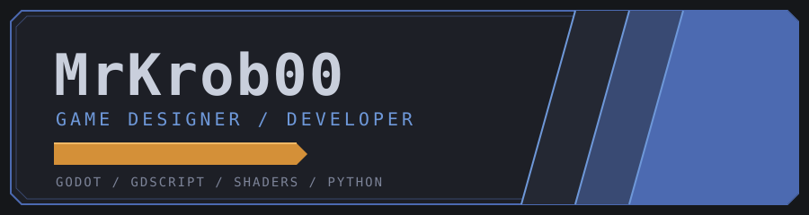
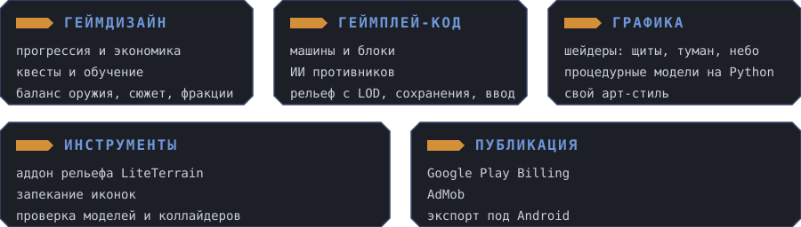

  

Game designer and developer. I create mobile games from the ground up: from rules and progression to shaders and code.
My core belief is that every number and every rule should have a reason that can be documented.

---

## Currently in progress

## What am I doing?

## Stack

  
  
  
  
  
  

## Statistics

  
  

## Connection

[mrkrob00@gmail.com](mailto:mrkrob00@gmail.com)
